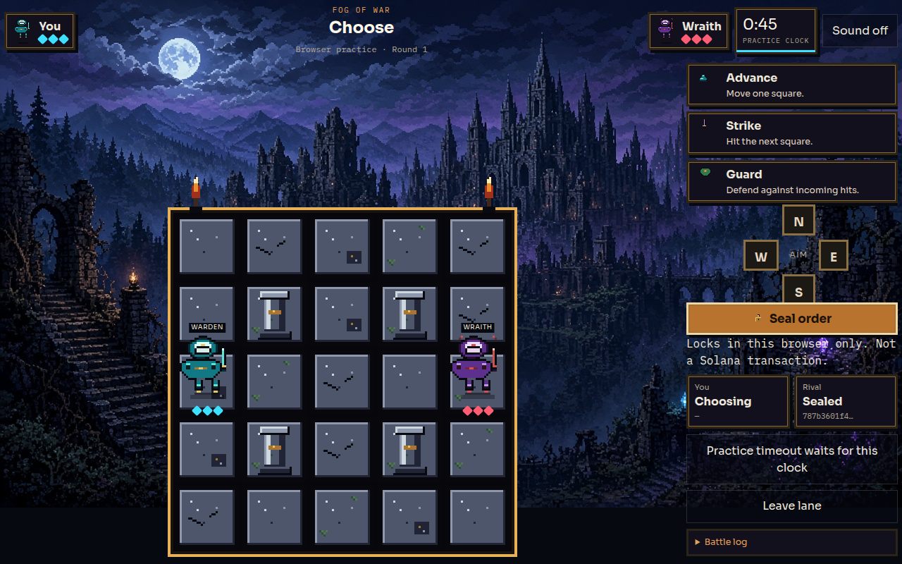

# Fog of War

A two-player simultaneous-turn arena. Fighters see the same 5×5 board. Each turn they seal one order — advance, strike, or guard — as a salted hash. After both seals are in, they reveal. A Solana program checks the preimage, rejects tampering and illegal actions, and resolves movement and combat with no randomness.

The board is public account data. The program does not hide it. Only the current order is concealed, and only until reveal.

## Rules

- West starts at `(0,2)` with 3 health. East starts at `(4,2)`. Pillars block `(1,1)`, `(3,1)`, `(1,3)`, and `(3,3)`.
- Advance: one orthogonal step onto an in-bounds square that is not a pillar.
- Strike: stay put and hit the adjacent square if the rival occupies it after movement. One damage.
- Guard: stay put and cancel every hit taken that turn.
- If both destination squares are the same, both fighters hold. If they would swap through each other, both hold. A fighter may step into a square the other one is leaving.
- Both reaching 0 health in the same resolution is a draw. After 8 turns, the higher health wins; equal health draws.
- Commit and reveal windows are 15 to 180 seconds, stored on the match. After the clock:
  - commit phase, only one seal: the sealed fighter wins; neither seal: draw
  - reveal phase, only one reveal: the fighter who revealed wins; neither reveal: draw
- A finished match cannot be reset. Rematch creates a new account. An illegal sealed action cannot be swapped for a legal one; the reveal fails and the clock can forfeit that fighter.

Commitment preimage:

```text
sha256("fog-of-war-v1" || match || turn_le || seat || action || direction || salt_32)
```

## Architecture

- `program/` — Rust program (`solana-program` 3.0). Instructions: init, commit, reveal, timeout. Match PDA seeds are `["match", player_a, nonce]`.
- `lib/` — the same rules, hash, and account codec in TypeScript. Shared vectors live in `fixtures/`.
- `app/` and `components/` — Next.js arena. Practice lane runs the local rules engine. Ledger duel sends signed transactions and reads the account back.
- `bot/server.ts` — separate process. It chooses from public positions only, stores the salt outside the browser, and submits its own transactions. It rejects any request that includes a move preimage.
- `scripts/localnet.sh` — build, boot `solana-test-validator`, deploy, write `public/program.json`.

Practice lane seals the rival before you choose, but that seal is only a closure in the same browser. It is not a trust boundary. The ledger duel is the one where the rival's salt is in another process and the program enforces order: reveal is impossible until both commits land, and a reveal cannot change the sealed bytes.

The rival is a fixed policy (close distance, strike when adjacent, guard at 1 health if the trade is bad). It is not a language model.

## Art

Sprite sheets, tiles, effects, and short sound cues are original and generated by `npm run assets` (`scripts/build-pixel-assets.mjs`). Warden and Wraith sheets are 4 columns by 10 rows. Each frame is 32×48: idle, walk south, walk north, walk east, walk west, attack, guard, hit, victory, defeat. Floor tiles are 32×32. Nothing is copied from the reference games. Sound stays muted until the player turns it on. Notes are in `public/assets/README.md`.

`public/assets/environment/ruined-city.jpg` is original generated scenery (a moonlit ruined city, 1280×720). It is the page background, not a tile and not an obstacle. `public/assets/environment/platform.png` is the stone apron around the 5×5. That integration was still in progress when this snapshot was packed: the playable grid is still the original 25 squares.

This repository was written with AI assistance. The rules, the program, and the tests are in the tree so they can be read and rerun. Event policy on AI-assisted entries was not verified. Do not treat this note as permission from the organizers.

## Status

Supported chain path: a local `solana-test-validator` only. `evidence/localnet-abc.json` records that validator’s signatures. They are not devnet or mainnet explorer records, and they exist only while that validator process is running. A simulated rejection has no signature.

Not verified here: a devnet deploy, a browser wallet such as Phantom, and any public host. No mainnet and no wagers.

## Demo media



[Local practice clip](docs/demo.mp4)

That clip is a browser practice turn. It is not a devnet transaction recording.

## Run

```bash
npm install
npm run test:ts
cargo test --manifest-path program/Cargo.toml
bash scripts/localnet.sh
npm run bot
npm run smoke:local
npm run demo:local
npm run dev
```

Arena: `http://127.0.0.1:3847`

`npm run demo:local` runs three local-validator matches and writes `evidence/localnet-abc.json`: a normal commit/reveal hit, a rejected second commit (`0x2`, hash unchanged), and a missed-reveal forfeit after the deadline (`0x6` if asked too early). Those signatures exist only on `http://127.0.0.1:8899` while that validator is running. They are not devnet explorer records. A simulation rejection has no signature.

The bot listens on `127.0.0.1:3921`. The dev server proxies `/bot/*` to it. On a local validator, airdrop the rival from the ledger screen if its first transaction says it is short on SOL.

Generated keypairs (`bot/.bot-keypair.json`, the Solana CLI id, and the program keypair under `program/target`) stay out of git. Do not print them.

## Devnet

Not deployed from this workspace. The precise gap is a funded devnet payer:

```bash
solana config set --url devnet
solana-keygen new -o devnet-payer.json
solana airdrop 2 "$(solana-keygen pubkey devnet-payer.json)" --url devnet
solana program deploy program/target/deploy/fog_of_war.so \
  --program-id program/target/deploy/fog_of_war-keypair.json \
  --url devnet \
  --keypair devnet-payer.json
```

Write the resulting program id into `public/program.json` with `"cluster": "devnet"`. The arena shows an explorer link only for devnet signatures. Local signatures stay as raw ids. Devnet airdrops are often rate-limited; if this fails, the local validator path above is the supported demo. No mainnet, no wagers.

## Tests

```bash
cargo test --manifest-path program/Cargo.toml
npm run test:ts
```

Rust covers the rules vectors plus on-chain cases: bad windows, same player, re-init, single commit does not move, outsider commit, tampered reveal, changed action, illegal commitment, double reveal, replay onto a later turn and another match, collision, crossing, guard, knockout, mutual draw, turn-cap draw, pillar move, early timeout, late commit, one-sided forfeit, both-stalled draw, reveal forfeit, and no commit after the match ends.

## Limits

- Native `solana-program-test` executes the instruction logic directly. `scripts/localnet.sh` is the SBF deploy path; trust that deploy only after the script prints a program id.
- The bot can lose a seal if its private seal file is deleted. The on-chain timeout is the recovery.
- No token economy and no LLM adapter. Gaming behavior comes first.
- Event policy on AI-assisted coding was not verified here. Do not assume it is permitted.
