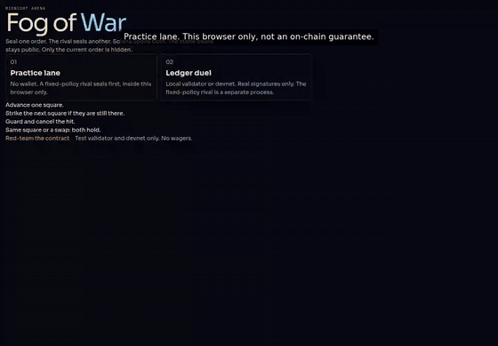
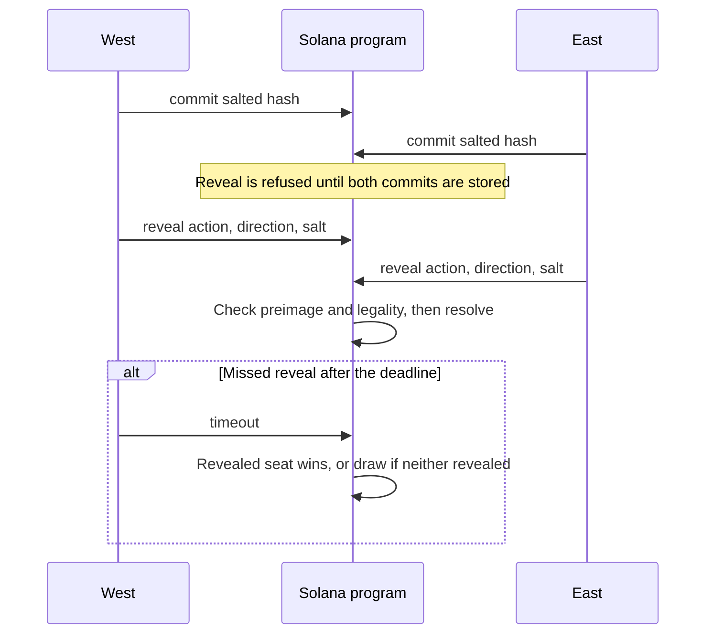
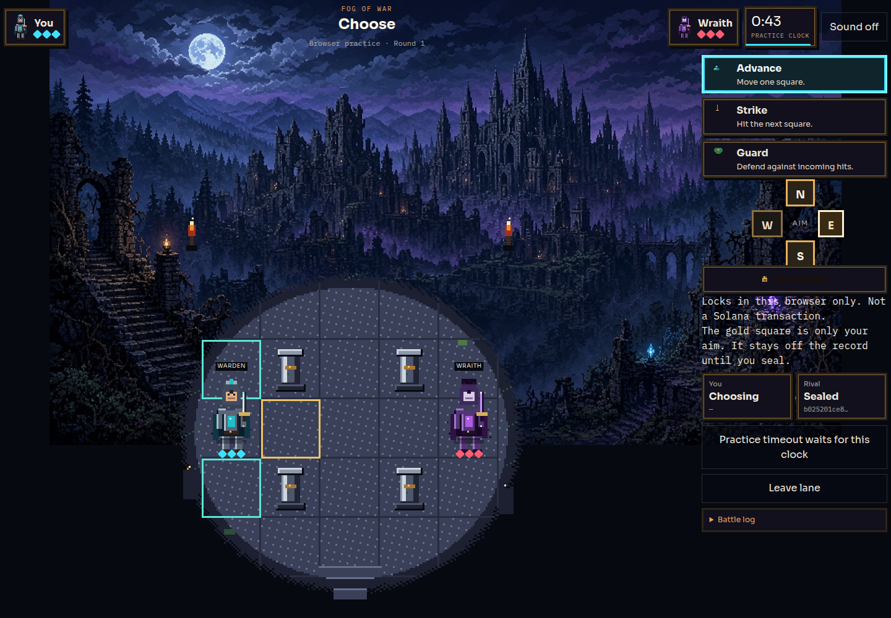
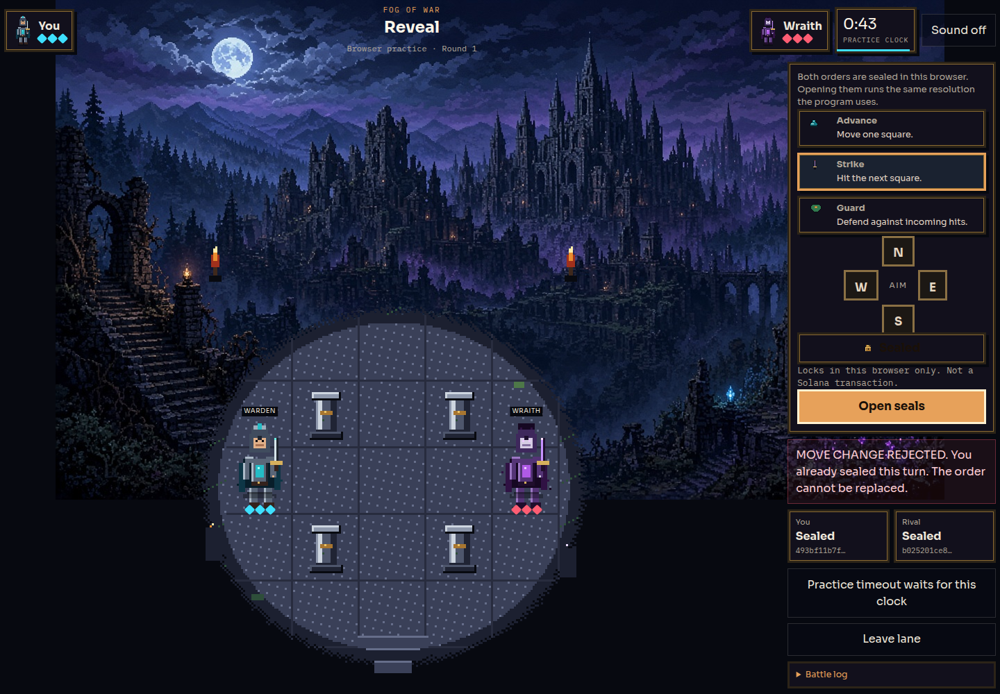
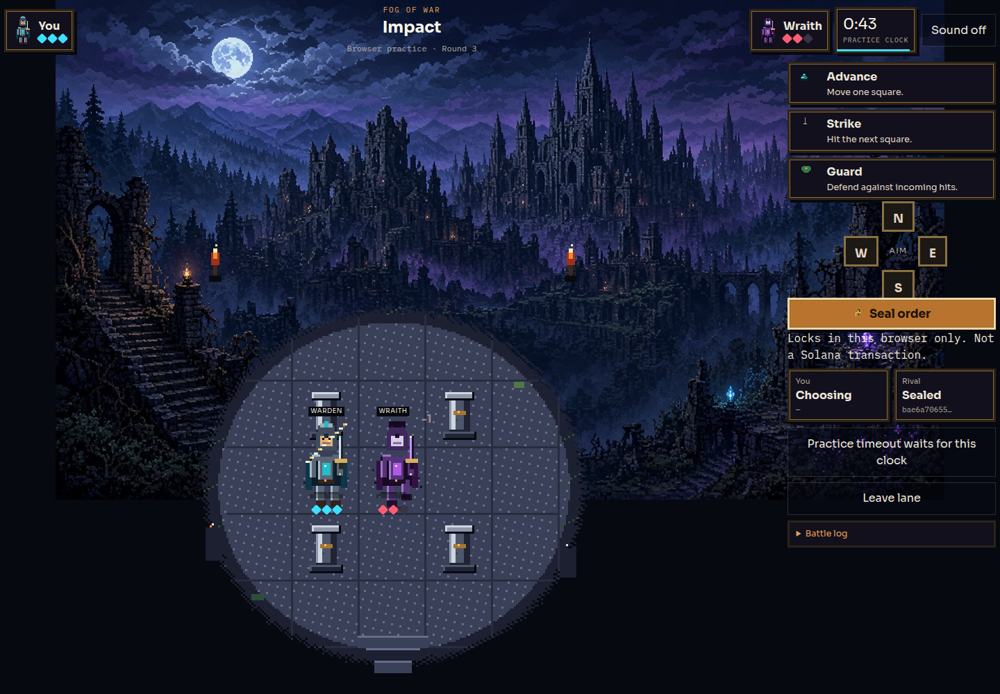
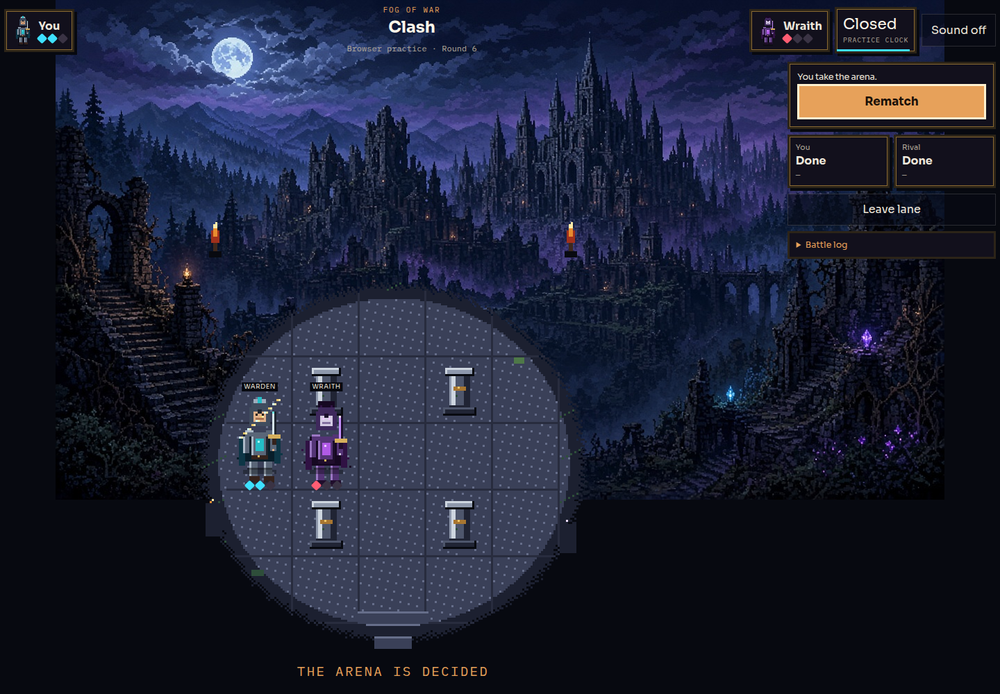
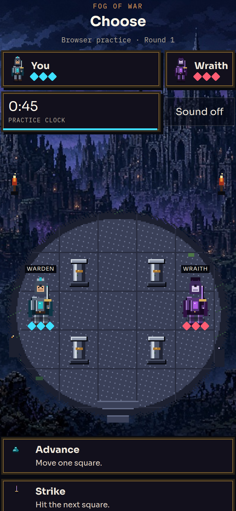

# Fog of War

A two-player simultaneous-turn arena. Both fighters see the same 5×5 board. Each turn they seal one order — Advance, Strike, or Guard — as a salted hash. After both seals are in, they reveal. A Solana program checks the preimage, rejects tampering and illegal actions, and resolves movement and combat with no randomness.

The board is public account data. The program does not hide it. Only the current order is concealed, and only until reveal.


## Watch a match

The file is a 61-second screen capture of the browser practice lane (1440×1000 H.264). GitHub does not play an in-repo MP4 inside the README, so the image below is a preview. Click it to open `docs/demo.mp4`.

[](docs/demo.mp4)

[docs/demo.mp4](docs/demo.mp4)

That clip starts on the board within the first second. It shows Advance, Strike, and Guard, a rejected replacement of a sealed order, reveal, hits that change health, and a match result. On-screen captions state what the pictures already say: this is practice mode in the browser. It is not a local-validator transaction, and it is not a devnet or mainnet recording.

## How it works

West starts at `(0,2)` with 3 health. East starts at `(4,2)`. Pillars block `(1,1)`, `(3,1)`, `(1,3)`, and `(3,3)`.

- **Advance:** one orthogonal step onto an in-bounds square that is not a pillar.
- **Strike:** stay put and hit the adjacent square if the rival occupies it after movement. One damage.
- **Guard:** stay put and cancel every hit taken that turn.

If both destination squares are the same, both fighters hold. If they would swap through each other, both hold. A fighter may step into a square the other one is leaving. Both reaching 0 health in the same resolution is a draw. After 8 turns, the higher health wins; equal health draws.

Commit and reveal windows are 15 to 180 seconds, stored on the match. After the clock:

- commit phase, only one seal: the sealed fighter wins; neither seal: draw
- reveal phase, only one reveal: the fighter who revealed wins; neither reveal: draw

A finished match cannot be reset. Rematch creates a new account. An illegal sealed action cannot be swapped for a legal one. The reveal fails, and the clock can forfeit that fighter.

Commitment preimage:

```text
sha256("fog-of-war-v1" || match || turn_le || seat || action || direction || salt_32)
```

The rival in practice and in the local bot is a fixed policy: close distance, strike when adjacent, guard at 1 health if the trade is bad. It is not a language model. It reads public positions and health only.



## Architecture

Verified from this repository, not from a guessed stack.

| Piece | What it is |
| --- | --- |
| `app/`, `components/` | Next.js 16.4.5 and React 19. The dev server uses Turbopack. Styling is Tailwind CSS 4. |
| `lib/chain.ts` | `@solana/web3.js` 1.98.4. Phantom is used only when `window.solana` is injected. Local matches can use an ephemeral key that stays in the tab. There is no wallet-adapter package. |
| `lib/hash.ts` | `@noble/hashes` for the same SHA-256 commitment the program checks. |
| `program/` | Native Rust program on `solana-program` 3.0.0 and `solana-system-interface` 3.1.0. Not Anchor. Instructions are init, commit, reveal, and timeout. Match PDA seeds are `["match", player_a, nonce]`. |
| `lib/` | The same rules, hash, and account codec in TypeScript. Shared vectors live in `fixtures/`. |
| `bot/server.ts` | A separate Node process (`tsx`). It stores the salt outside the browser and submits its own transactions. It rejects any request that includes a move preimage. |
| Tests | `tsx --test` for TypeScript. `cargo test` with `solana-program-test` 4.0 for the program. |

Practice lane seals the rival before you choose, but that seal is only a closure in the same browser. It is not a trust boundary. The ledger duel is the path where the rival's salt is in another process and the program enforces order: reveal is impossible until both commits land, and a reveal cannot change the sealed bytes.

## Screenshots

Captured from the running app on this machine. Practice mode, unless noted.

| | |
| --- | --- |
|  | **Match start.** Round 1, both fighters on the public 5×5. The rival's hash is already sealed inside this browser. |
|  | **Choosing Advance east.** The gold square is only an aim until Seal order. |
|  | **Commit and reveal.** Both salted hashes are shown. A second order is rejected: the sealed bytes cannot be replaced. Opening them runs the same resolution the program uses. Still this browser, not a Solana transaction. |
|  | **Combat.** Impact on the strike that catches the rival stepping in. Health updates from that resolution. |
|  | **Result.** The arena is decided. Rematch starts a new practice match in the tab. |
|  | **Mobile.** Same practice lane at 390×844. The board stacks above the orders. |

## Quick start

Commands below were run in this workspace on 9 Nov 2026, except where a line says it was not run.

Needs Node.js (this run: Node 22) and a Cargo that supports Rust edition 2024 (this run: rustc 1.99.1). Cargo 1.83 stopped on a dependency that requires edition 2024. `scripts/localnet.sh` also needs the Agave CLI tools `cargo-build-sbf` and `solana-test-validator`. The script looks for them on `PATH` and under `~/.local/share/solana/install/active_release/bin`. This run used Solana CLI 4.3.2 and cargo-build-sbf 4.4.0.

```bash
npm install
npm run test:ts
cargo test --manifest-path program/Cargo.toml
bash scripts/localnet.sh
npm run demo:local
```

`bash scripts/localnet.sh` builds the SBF program, boots `solana-test-validator` on `http://127.0.0.1:8899` if needed, deploys, and writes `public/program.json`. That file is gitignored. The program id exists only while that validator process is running.

`npm run demo:local` is the chain proof for [DEMO.md](DEMO.md) scenarios A, B, and C. No wallet. Ephemeral keys stay in memory. It rewrites `evidence/localnet-abc.json` with signatures that are valid only on that local validator. This run's evidence file was not committed, so the copy in git is still the earlier local snapshot and is not a devnet explorer record.

Browser and bot, after the validator is up:

```bash
npm run bot
npm run dev
```

The bot listens on `127.0.0.1:3921`. The dev server is `http://127.0.0.1:3847` and proxies `/bot/*` to it. Practice lane needs neither the bot nor the validator. Ledger duel does.

`npm run smoke:local` talks to the bot and the local validator. It checks a tampered reveal, an unchanged hash after a rejected second commit, and a missed-reveal forfeit.

Generated keypairs (`bot/.bot-keypair.json`, the Solana CLI id, and the program keypair under `program/target`) stay out of git. Do not print them.

## Tests and build, this run

| Command | Result |
| --- | --- |
| `npm run test:ts` | 22 passed, 0 failed (`tsx --test`) |
| `cargo test --manifest-path program/Cargo.toml` | 11 passed, 0 failed; doc-tests 0. rustc 1.99.1 |
| `bash scripts/localnet.sh` | Exit 0. Deployed to `http://127.0.0.1:8899` |
| `npm run demo:local` | A: commit, reveal, hit, positions 11 and 12, east health 2. B: second commit rejected `0x2`, stored hash unchanged. C: timeout before the deadline rejected `0x6`, then missed-reveal forfeit, winner west, flags `4096`, positions still 10 and 14 |
| `npm run smoke:local` | Tampered reveal rejected `0x4`. Second commit rejected `0x2`. Early timeout rejected `0x6`. Reveal forfeit, winner west |
| `npm run build` | Next.js 16.4.5 compiled, TypeScript check finished, static pages generated for `/` and `/audit` |

Rust tests cover the shared rules vectors plus on-chain cases: bad windows, same player, re-init, a single commit does not move, outsider commit, tampered reveal, changed action, illegal commitment, double reveal, replay onto a later turn and another match, collision, crossing, guard, knockout, mutual draw, turn-cap draw, pillar move, early timeout, one-sided forfeit, both-stalled draw, reveal forfeit, and no commit after the match ends.

`npm run dev` was used to capture the screenshots and `docs/demo.mp4`. A clicked Phantom session was not part of that capture.

## Status

Tested on a local validator only. There is no devnet deployment from this workspace, and no devnet or mainnet explorer link. No mainnet. No wagers.

Not verified here:

- A funded devnet deploy. The commands in the old notes (`solana config set --url devnet`, a new payer, `solana airdrop`, `solana program deploy`) were not run.
- The browser wallet flow. Phantom was not injected in this environment. The ledger screen can create an ephemeral local key, and that path was not the one recorded in the demo video.
- Practice mode. It is browser-only. The rival's seal is a closure in the same tab. It is not an on-chain guarantee and not a private opponent.

Native `solana-program-test` executes the instruction logic directly. `scripts/localnet.sh` is the SBF deploy path. Trust that deploy only after the script prints a program id.

The bot can lose a seal if its private seal file is deleted. The on-chain timeout is the recovery. There is no token economy.

## Disclosure

Development of this repository used AI coding assistance (Cursor). The rules, the program, and the tests are in the tree so they can be read and rerun.

`public/assets/environment/ruined-city.jpg` is original AI-generated art: the moonlit city behind the page. It is not a tile and not an obstacle. Sprite sheets, tiles, effects, and the short sound cues are produced by `npm run assets` (`scripts/build-pixel-assets.mjs`). Notes are in `public/assets/README.md`. Nothing in that set is copied from the reference games. Sound stays muted until the player turns it on.

## License

[MIT](LICENSE). Copyright (c) 2026 Phantom9869.
